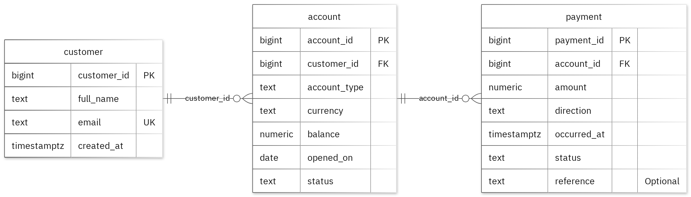
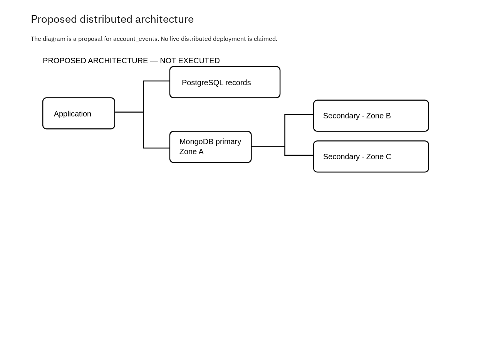

# Bank / Fintech Platform:<br/> 
**Advanced Database Systems Portfolio**

**Student:** Vivian Onuchukwu·<br/> 
**Student ID:** 301901029<br/> 
**Programme:** MSc Information Technology (MIT), Miva Open University<br/> 
**Module:** MIT 8103 Advanced Database Systems<br/> 
**Repository:** https://github.com/VivianOnuchukwuMSC/ONUCHUKWU_VIVIAN_301901029

---

## 1. Overview

This repository contains my five-part portfolio for MIT 8103 Advanced Database Systems. All five parts use one case study, a **Bank / Fintech Platform**, and take the same data through five stages: relational design, query optimisation, transactions and concurrency, NoSQL modelling, and distributed/cloud architecture.

All data is **fictional**. Names, emails, balances and payments are invented for demonstration only, and email addresses use the reserved `example.test` domain.

### Case study

The platform serves two groups of users:

- **Customers**, who review their accounts and payment history.
- **Bank operations staff**, who monitor account activity.

It supports three main operations:

1. Open an account for a customer.
2. Record and review account payments.
3. Summarise payment activity by customer.

### Technologies

| Area | Technology |
| --- | --- |
| Relational database | PostgreSQL (documentation references are to v17) |
| Document database | MongoDB (queried through `mongosh`) |
| Diagrams | Mermaid (ER diagram), PNG exports |
| Documentation | Markdown, with a PDF copy of the final summary |

---

## 2. Repository structure

```
ONUCHUKWU_VIVIAN_301901029/
├── README.md                                   ← this file
├── ONUCHUKWU_VIVIAN_301901029_FinalSummary.md  ← final report (Markdown)
├── ONUCHUKWU_VIVIAN_301901029_FinalSummary.pdf ← final report (PDF)
├── images/
│   └── ONUCHUKWU_VIVIAN_301901029_ERDiagram.png
│
├── portfolio-1-database-design/
│   ├── ..._P1_README.md              summary and run instructions
│   ├── ..._P1_Design.md              entities, fields, rules, assumptions
│   ├── ..._P1_ERDiagram.md           Mermaid ER diagram
│   ├── ..._P1_Normalisation.md       1NF → 2NF → 3NF walkthrough
│   ├── ..._P1_Schema.sql             CREATE statements and constraints
│   ├── ..._P1_SampleData.sql         fictional sample records
│   ├── ..._P1_ConstraintTests.sql    10 deliberately invalid inserts
│   └── screenshots/                  database results image
│
├── portfolio-2-query-optimisation/
│   ├── ..._P2_README.md              queries, results, execution plans
│   ├── ..._P2_Queries.sql            three queries with EXPLAIN
│   ├── ..._P2_Optimisation.sql       25,000-row index experiment
│   └── screenshots/                  query results, index comparison
│
├── portfolio-3-transactions-concurrency/
│   ├── ..._P3_README.md              results and analysis
│   ├── ..._P3_Transactions.sql       COMMIT / ROLLBACK exercise
│   ├── ..._P3_SessionA.sql           two-session script, session A
│   ├── ..._P3_SessionB.sql           two-session script, session B
│   └── screenshots/                  commit/rollback, concurrency result
│
├── portfolio-4-nosql/
│   ├── ..._P4_README.md              document model, queries, validation
│   ├── ..._P4_MongoDB.js             full mongosh script
│   └── screenshots/                  documents and queries image
│
└── portfolio-5-distributed-cloud/
    ├── ..._P5_README.md              replication, consistency, sharding
    └── screenshots/                  proposed architecture diagram
```

*(`...` stands for the prefix `ONUCHUKWU_VIVIAN_301901029`.)*

---

## 3. Portfolio summaries

### Portfolio 1: Database Design and Modelling

**Goal:** design a normalised relational schema that enforces the bank's business rules in the database itself.

**Design.** Three tables in a PostgreSQL schema called `portfolio`:

| Table | Purpose | Key fields |
| --- | --- | --- |
| `customer` | Customer identity | `customer_id` (PK), `full_name`, `email` (unique), `created_at` |
| `account` | An account owned by one customer | `account_id` (PK), `customer_id` (FK), `account_type`, `currency`, `balance`, `opened_on`, `status` |
| `payment` | A payment against one account | `payment_id` (PK), `account_id` (FK), `amount`, `direction`, `occurred_at`, `status`, `reference` (optional) |

**Relationships:** one customer has zero or many accounts, and one account has zero or many payments.

**Business rules enforced by constraints**

| Rule | Mechanism |
| --- | --- |
| Each email identifies at most one customer | `UNIQUE (email)` |
| Every account references an existing customer | Foreign key `fk_account_0` |
| Every payment references an existing account | Foreign key `fk_payment_0` |
| Balance must be zero or greater | `CHECK (balance >= 0)` (`account_nonnegative_balance`) |
| Payment amount must be greater than zero | `CHECK (amount > 0)` (`payment_positive_amount`) |
| A payment reference, when present, must be unique | Partial unique index `payment_reference_if_present_unique` (`WHERE reference IS NOT NULL`) |

**Normalisation.** The documented example starts with grouped records (a customer with a list of accounts). It moves to 1NF (one value per cell), checks 2NF (no partial dependencies, since each key is a single column), and reaches 3NF by splitting each entity's own details into its own table. Joining the decomposed tables reproduces the original two example rows.

**Evidence.** Ten deliberately invalid inserts were rejected at their expected constraints and left the valid sample rows unchanged:

| # | Invalid insert | Expected error |
| --- | --- | --- |
| 1 | Duplicate customer PK | `pk_customer` (23505) |
| 2 | Duplicate customer email | `uq_customer_0` (23505) |
| 3 | NULL customer name | `full_name` NOT NULL (23502) |
| 4 | Duplicate account PK | `pk_account` (23505) |
| 5 | Account with non-existent customer | `fk_account_0` (23503) |
| 6 | Negative balance | `account_nonnegative_balance` (23514) |
| 7 | Duplicate payment PK | `pk_payment` (23505) |
| 8 | Payment with non-existent account | `fk_payment_0` (23503) |
| 9 | Zero payment amount | `payment_positive_amount` (23514) |
| 10 | Duplicate payment reference | `payment_reference_if_present_unique` (23505) |



---

### Portfolio 2: Query Processing and Optimisation

**Goal:** write representative queries, then measure the effect of an index using execution plans.

**Queries** (run on the Portfolio 1 sample data, each paired with `EXPLAIN (ANALYZE, BUFFERS, FORMAT JSON)`):

1. **Join:** list each customer with their accounts (returned 2 rows, including Mira Chen with a checking account).
2. **Filter:** find payments where `occurred_at` matches `2025-03-01T10:20:00Z` (returned payment 301).
3. **Aggregate:** count accounts per `customer_id` (returned 1 account each for customers 101 and 102).

**Index experiment.** Because the sample data is too small to measure, a separate `query_lab.payment` table was created with 25,000 generated rows. It copies only the `occurred_at` type and a lab row ID, so the Portfolio 1 constraints are not affected. A selective equality lookup was timed three times before and after creating a B-tree index (`p2_filter_idx`) on `occurred_at`.

| Phase | Median (ms) | Runs (ms) | Plan | Buffer hits |
| --- | --- | --- | --- | --- |
| Before index | **1.232** | 1.218, 1.232, 1.239 | Sort → Seq Scan | 139 |
| After index | **0.193** | 0.193, 0.203, 0.189 | Sort → Bitmap Heap Scan → Bitmap Index Scan | 30 |

**Findings.** Median execution time fell from 1.232 ms to 0.193 ms (about 6.4× faster). Buffer hits fell from 139 to 30, and the planner switched from a sequential scan to the new index. Both phases returned the same 25 rows. Indexes add storage and write-maintenance cost, and these timings apply only to this lookup and environment.

---

### Portfolio 3: Transactions and Concurrency

**Goal:** demonstrate atomicity, isolation and the lost-update problem, and show how row locking prevents it.

A temporary helper column, `p3_processed_count`, was added to `account` (with a non-negative CHECK) so the experiments would not touch the real business fields. It exists only for this exercise and is **not** part of the Portfolio 1 design.

**Experiment A: COMMIT and ROLLBACK (READ COMMITTED)**

| Stage | Counter |
| --- | --- |
| Before COMMIT | 0 |
| Uncommitted change (own session) | 1 |
| Other session, before COMMIT | 0 |
| After COMMIT | 1 |
| After failed transaction and ROLLBACK | 1 |

A deliberately invalid update (counter set to `-1`) violated the CHECK (SQLSTATE 23514) and aborted the transaction. The `ROLLBACK` restored the earlier committed value, and READ COMMITTED kept the uncommitted change hidden from the other session.

**Experiment B: two concurrent sessions**

| Method | Final value | Expected |
| --- | --- | --- |
| Read, calculate, write (no locking) | 2 | 3 |
| `SELECT ... FOR UPDATE` | 3 | 3 |

Without locking, both sessions read `1` and both wrote `2`, so one increment was lost. With `SELECT ... FOR UPDATE`, Session B waited on a row lock until Session A committed. It then read `2` and wrote `3`, which is the correct result.

---

### Portfolio 4: NoSQL and Advanced Data Models

**Goal:** model payment-event history as documents in MongoDB and compare it with the relational model.

**Collection:** `account_events` in the `portfolio_nosql` database, holding `payment_authorized` and `payment_posted` events.

**Document structure**

| Field | Meaning |
| --- | --- |
| `_id` | Unique string event ID |
| `schemaVersion`, `simulation` | Version marker and a flag showing the data is fictional |
| `eventType` | `payment_authorized` or `payment_posted` |
| `occurredAt` | Native BSON Date (sample timestamps are in 2030) |
| `source` | Source entity, primary key and a snapshot of the payment record |
| `embedded` / `references` | Embedded snapshots and keys for linked sources |
| `details` | Flexible event metadata whose fields vary by event type |

**Implementation highlights**

- A `$jsonSchema` validator (strict, action `error`) enforces the stable fields while `details` stays flexible.
- A compound index on `{eventType: 1, occurredAt: -1}` (`event_type_time`) supports the query access fields.
- Four sample events were inserted, and four queries returned the expected results: by event type, by nested key (`source.key.payment_id`), by date range, and a count per event type by aggregation.
- Validation rejected an invalid date type (error **121**) and a duplicate event ID (error **11000**), leaving 4 valid documents.

**Trade-off.** Embedded snapshots make an event readable as one document, but they duplicate data, and later SQL changes do not update them automatically. PostgreSQL remains the authority for relational rules.

---

### Portfolio 5: Distributed and Cloud Database Exercise

**Goal:** a design discussion (the permitted discussion option) on running the platform across a distributed cloud deployment. **No cloud service was provisioned and no failover, replication, sharding or recovery test was run.**

**Proposed deployment**

- A **three-member MongoDB replica set** spread across three availability zones in one region.
- PostgreSQL needs its **own** high-availability setup. A MongoDB replica set does not replicate PostgreSQL.



**Key points**

| Topic | Summary |
| --- | --- |
| Replication | One primary accepts writes and two secondaries copy the oplog asynchronously. If the primary fails, a majority of voting members can elect a replacement, and writes may pause during the election. A partition without a majority cannot elect a primary. |
| Consistency | Proposed policy: majority write concern with a finite timeout, primary reads, and majority read concern where committed data is required. Secondary reads can lag. Retries need an idempotency key. |
| Cross-database limits | These settings do not give an atomic transaction across PostgreSQL and MongoDB. An outbox pattern with a retrying consumer would be a separate implementation. |
| Sharding | Not needed at sample scale. If `account_events` grew large, a high-cardinality hashed key could be evaluated. A time-only key can concentrate writes, and a hashed key can make time-range queries touch several shards. |
| Cloud and recovery | Real deployments need private networking, TLS, authentication, least-privilege roles, monitoring and tested backups. Replication copies accidental deletions, so it is not a backup. Availability zones are not regional disaster recovery. |

---

## 4. How to reproduce the work

### Prerequisites

- PostgreSQL 17 (or compatible) with `psql`
- MongoDB with `mongosh`
- Use a **fresh database** for each stage, because the scripts create schemas and collections and will fail if they already exist.

### Portfolio 1: schema, data and constraint tests

```bash
createdb bank_portfolio
psql -d bank_portfolio -f portfolio-1-database-design/ONUCHUKWU_VIVIAN_301901029_P1_Schema.sql
psql -d bank_portfolio -f portfolio-1-database-design/ONUCHUKWU_VIVIAN_301901029_P1_SampleData.sql
```

Then open `ONUCHUKWU_VIVIAN_301901029_P1_ConstraintTests.sql` and run each of the 10 statements **individually, outside a transaction**. Each should fail with the error listed in section 3.

### Portfolio 2: queries and index experiment

Use a database with the Portfolio 1 schema and sample data loaded.

```bash
psql -d bank_portfolio -f portfolio-2-query-optimisation/ONUCHUKWU_VIVIAN_301901029_P2_Queries.sql
psql -d bank_portfolio -f portfolio-2-query-optimisation/ONUCHUKWU_VIVIAN_301901029_P2_Optimisation.sql
```

Exact timings will vary by machine, but the Seq Scan to Bitmap Index Scan change should be reproducible.

### Portfolio 3: transactions and concurrency

1. Load the Portfolio 1 schema and sample data in a fresh database.
2. Run `ONUCHUKWU_VIVIAN_301901029_P3_Transactions.sql` (adds the helper column and runs the commit/rollback test).
3. Open **two `psql` terminals** connected to the same database.
4. Follow the numbered steps **1 to 9** across `..._P3_SessionA.sql` and `..._P3_SessionB.sql`. Step 5 (the reset) runs in Session A **outside** a transaction.

### Portfolio 4: MongoDB

```bash
mongosh --file portfolio-4-nosql/ONUCHUKWU_VIVIAN_301901029_P4_MongoDB.js
```

The script selects `portfolio_nosql`, creates the validated collection, inserts the four events, creates the index, runs the four queries and demonstrates both validation errors. It stops with an error if the collection already exists.

### Portfolio 5

Discussion only. Nothing to run.

---

## 5. Evidence and screenshots

| Portfolio | Evidence |
| --- | --- |
| 1 | `screenshots/ONUCHUKWU_VIVIAN_301901029_P1_DatabaseResults.png` |
| 2 | `..._P2_QueryResults.png`, `..._P2_IndexComparison.png` |
| 3 | `..._P3_CommitRollback.png`, `..._P3_ConcurrencyResult.png` |
| 4 | `..._P4_DocumentsAndQueries.png` |
| 5 | `..._P5_ProposedDesign.png` |

---

## 6. Limitations and honest notes

- All data is fictional and tiny, apart from the generated 25,000-row performance table in Portfolio 2.
- Index timings are specific to one lookup and one environment and are not general benchmarks.
- The Portfolio 3 helper column is for the exercise only and is not part of the real design.
- The MongoDB event snapshots are copies, so they can become stale if the SQL data changes.
- Portfolio 5 is a proposal and nothing was deployed or failure-tested.

---

## 7. AI-use declaration

I used GitHub Copilot and a portfolio generator to help prepare the database model, scripts and explanations. The generator ran the PostgreSQL and MongoDB exercises, checked their outputs and captured the result images. I remain responsible for checking and explaining the submitted work.

---

## 8. References

- [PostgreSQL: constraints](https://www.postgresql.org/docs/17/ddl-constraints.html)
- [PostgreSQL: EXPLAIN](https://www.postgresql.org/docs/17/using-explain.html)
- [PostgreSQL: transaction isolation](https://www.postgresql.org/docs/17/transaction-iso.html)
- [PostgreSQL: explicit locking (row locks)](https://www.postgresql.org/docs/17/explicit-locking.html)
- [MongoDB: data modelling](https://www.mongodb.com/docs/manual/data-modeling/)
- [MongoDB: replication](https://www.mongodb.com/docs/manual/replication/)
- [MongoDB: sharding](https://www.mongodb.com/docs/manual/sharding/)
- [Mermaid: ER diagrams](https://mermaid.js.org/syntax/entityRelationshipDiagram.html)

---

## 9. Further reading in this repository

- [Final summary (Markdown)](ONUCHUKWU_VIVIAN_301901029_FinalSummary.md) · [PDF](ONUCHUKWU_VIVIAN_301901029_FinalSummary.pdf)
- Individual portfolio READMEs inside each `portfolio-*` folder
-
-


        


# 2. Query Optimisation & Indexing (portfolio-2-query-optimisation/)
Focus: Identifying bottlenecks in complex joins, aggregate queries, and subqueries.

Key Artifacts: Unoptimised vs. tuned scripts (_P2_Queries.sql, _P2_Optimisation.sql) backed by execution plan screenshots.

Highlights: Implements strategic composite and covering indexes to drastically minimize cost metrics and execution time.

# 3. Transactions & Concurrency Control (portfolio-3-transactions-concurrency/)
Focus: Ensuring ACID properties, managing isolation levels, and diagnosing concurrency anomalies (e.g., Dirty Reads, Non-Repeatable Reads, Phantoms, Deadlocks).

Key Artifacts: Concurrent simulation sessions (_P3_SessionA.sql, _P3_SessionB.sql) and transaction scripts.

Highlights: Illustrates fine-grained control over locks, commits, and rollbacks.

# 4. NoSQL Document Modeling (portfolio-4-nosql/)
Focus: Transitioning from relational paradigms to flexible schema design using MongoDB.

Key Artifacts: Native aggregation pipeline scripts and collection queries (_P4_MongoDB.js).

Highlights: Optimized embedding versus referencing strategies tailored for high read-throughput web and mobile workloads.

# 5. Distributed Cloud Architecture (portfolio-5-distributed-cloud/)
Focus: Designing resilient, highly available, and horizontally scalable cloud infrastructures.

Key Artifacts: Architectural blueprints and structured documentation (_P5_README.md).

Highlights: Explores multi-region database replication, sharding strategies, load balancing, and fault tolerance.

### 🚀 Getting Started / Execution Instructions
Prerequisites
A running relational database engine (e.g., PostgreSQL or MySQL) for Portfolio parts 1 to 3.

MongoDB Shell (mongosh) or MongoDB Compass for Portfolio part 4.

### Step-by-Step Execution
Setup Relational Schema:

SQL
-- Run in your SQL client
\i portfolio-1-database-design/ONUCHUKWU_VIVIAN_301901029_P1_Schema.sql
\i portfolio-1-database-design/ONUCHUKWU_VIVIAN_301901029_P1_SampleData.sql
Test Constraints:

SQL
\i portfolio-1-database-design/ONUCHUKWU_VIVIAN_301901029_P1_ConstraintTests.sql
Run Query Optimisation Tests:
Execute scripts inside portfolio-2-query-optimisation/ with execution plans (EXPLAIN / EXPLAIN ANALYZE) enabled.

Execute NoSQL Scripts:

Bash
mongosh < portfolio-4-nosql/ONUCHUKWU_VIVIAN_301901029_P4_MongoDB.js

# 📄 License & Academic Integrity
This work was completed independently as part of coursework requirements at MIVA Open University. All rights reserved.

The portfolio uses fictional records for Bank / Fintech Platform.

- [Portfolio 1](portfolio-1-database-design/)
- [Portfolio 2](portfolio-2-query-optimisation/)
- [Portfolio 3](portfolio-3-transactions-concurrency/)
- [Portfolio 4](portfolio-4-nosql/)
- [Portfolio 5](portfolio-5-distributed-cloud/)

[Final summary](ONUCHUKWU_VIVIAN_301901029_FinalSummary.md) · [PDF](ONUCHUKWU_VIVIAN_301901029_FinalSummary.pdf)
